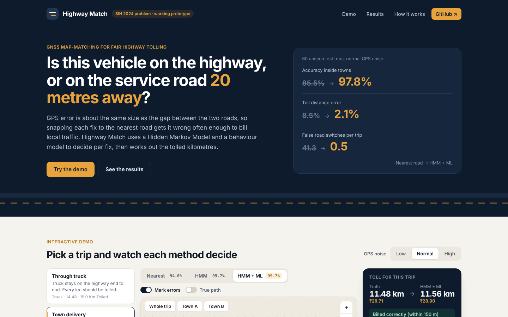
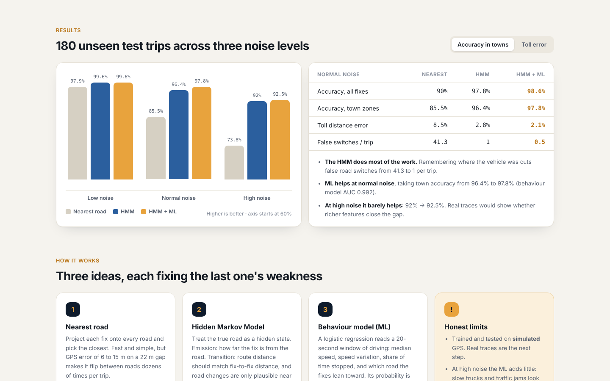
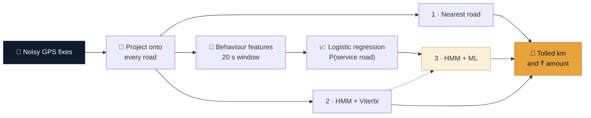
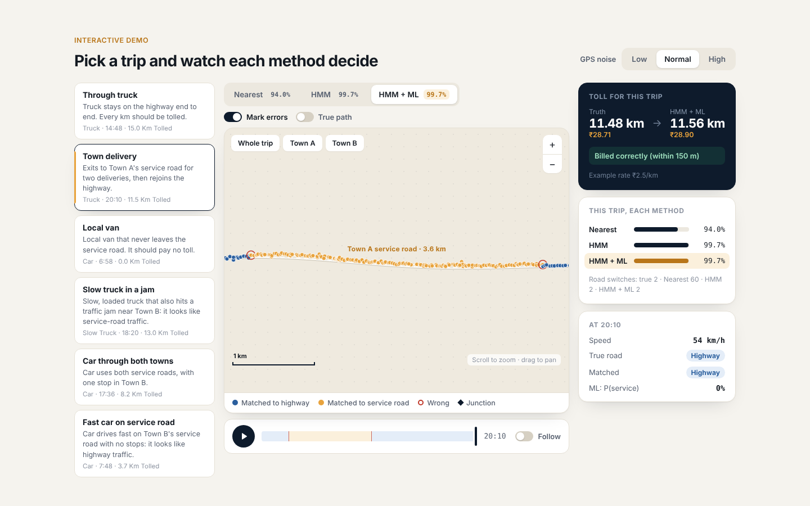
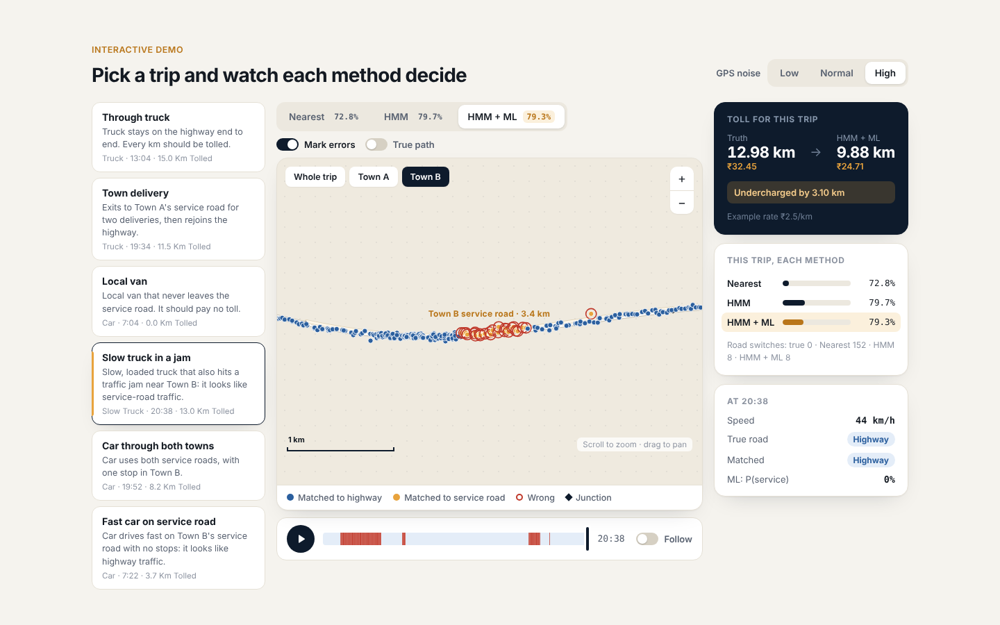

<div align="center">

# 🛣️ Highway Match

### Is this vehicle on the highway, or on the service road 20 metres away?

**GNSS map-matching for fair highway tolling: nearest-road vs Hidden Markov Model vs HMM + machine learning**

[](https://highway-match.vercel.app)
[](#-background)


[The problem](#-the-problem) · [Results](#-results) · [How it works](#-how-it-works) · [Demo](#-the-demo) · [Run it](#-run-it) · [Limits](#-honest-limits)

<br />



</div>

---

## 🎯 The problem

With **GNSS-based tolling**, a vehicle pays for the highway kilometres it actually drives, measured from its GPS. The hard part is that many highways have a **service road running alongside**, about 20 metres away, used by local traffic that should not pay.

GPS error is often **6 to 15 metres**, and worse inside towns. That is the same size as the gap between the two roads. So:

- Snap each fix to the nearest road, and the vehicle appears to **jump between roads dozens of times per trip**.
- Local vans get billed for highway they never used, and some highway kilometres go unbilled.

**Goal:** decide, for every GPS fix, which road the vehicle is really on, then compute the tolled distance correctly.

## 📊 Results

Measured on **180 unseen test trips** (60 per noise level), none of which were used for training.

| Normal GPS noise | Nearest road | HMM | **HMM + ML** |
| --- | ---: | ---: | ---: |
| Accuracy, all fixes | 90.0% | 97.8% | **98.6%** |
| Accuracy, inside towns | 85.5% | 96.4% | **97.8%** |
| Toll distance error | 8.5% | 2.8% | **2.1%** |
| False road switches per trip | 41.3 | 1.0 | **0.5** |

<details>
<summary><b>All three noise levels</b></summary>

| Town accuracy | Nearest road | HMM | HMM + ML |
| --- | ---: | ---: | ---: |
| Low noise | 97.9% | 99.6% | 99.6% |
| Normal noise | 85.5% | 96.4% | **97.8%** |
| High noise | 73.8% | 92.0% | 92.5% |

| Toll distance error | Nearest road | HMM | HMM + ML |
| --- | ---: | ---: | ---: |
| Low noise | 1.4% | 1.2% | 1.3% |
| Normal noise | 8.5% | 2.8% | **2.1%** |
| High noise | 17.9% | **7.3%** | 7.7% |

The behaviour model alone separates highway from service-road fixes with an **AUC of 0.992** on unseen town fixes.

</details>

### What I learned

1. **The HMM does most of the work.** Simply remembering where the vehicle was, and allowing road changes only near junctions, cuts false switches from 41 to 1 per trip.
2. **ML helps at normal noise** (96.4% → 97.8% in towns, toll error 2.8% → 2.1%).
3. **At high noise, ML barely helps**, and toll error is slightly worse. Slow loaded trucks and traffic jams drive like service-road traffic, so behaviour stops being a reliable signal. This is the first thing I'd test on real traces.



---

## 🧠 How it works



### 1 · Nearest road (baseline)
Project each fix onto every road and pick the closest. No memory between fixes.

### 2 · Hidden Markov Model (Newson & Krumm style)
The true road is a **hidden state**; each GPS fix is a noisy observation of it.

- **Emission:** a fix far from a road is unlikely to belong to it, so log-probability is −½(d / σ)² with σ = 8 m.
- **Transition (same road):** the distance travelled along the road should match the straight-line distance between fixes: −|Δroute − Δfix| / β with β = 12 m.
- **Transition (road change):** plausible only within 160 m of a junction; elsewhere it is heavily penalised.
- **Viterbi** finds the most likely sequence of roads for the whole trip.

### 3 · HMM + behaviour model (ML)
A logistic regression reads a **20-second window** of driving around each fix:

| Feature | Why it helps |
| --- | --- |
| Median speed | Service roads are slower |
| Speed variation | Town traffic is stop-start |
| Share of time stopped | Deliveries and junction stops happen on service roads |
| Lean | Whether fixes sit consistently closer to the service road |
| Lean variation | Real lean is steady; noise flips sign |
| Distance to highway | How far the fixes sit from the highway |

Its probability is added to the HMM's emission (weight 1.5, tuned on separate validation trips), so the HMM still enforces smooth, junction-only road changes.

### 🧾 Tolled distance
For every continuous run on the highway, the tolled distance is the distance along the highway between the run's first and last fix. Summing fix-to-fix steps instead would let GPS jitter add phantom kilometres.

---

## 🕹️ The demo

The web app runs **all three matchers in your browser** and reproduces the Python results **exactly** (verified: 22,491 of 22,491 fixes identical).

<table>
<tr>
<td><p align="center"><b>Nearest road</b>: red rings are wrong fixes</p></td>
<td><p align="center"><b>HMM + ML</b>: same trip, almost no errors</p></td>
</tr>
</table>

**Six scenarios**, each testing one hard case, at three noise levels:

| Scenario | What it tests |
| --- | --- |
| Through truck | Highway end to end: every km should be billed |
| Town delivery | Exits to the service road for two stops, then rejoins |
| Local van | Never leaves the service road: should pay nothing |
| Slow truck in a jam | Highway driving that *looks* like service-road driving |
| Car through both towns | Two exits and re-entries |
| Fast car on service road | Service-road driving that *looks* like highway driving |

**Features:** pan and zoom map, playback with follow mode, colour-coded timeline of errors, live toll in ₹ for each method, per-trip accuracy, and the ML's P(service road) at every moment.


<p align="center"><i>A failure case on purpose: at high noise, a slow truck stuck in a jam near Town B is mistaken for service-road traffic.</i></p>

---

## 🛰️ Simulated GNSS, modelled on real error

There is no public labelled dataset for this exact problem, so the project includes a simulator. Real GNSS error is not just random scatter, so it models five effects:

| Effect | How it's modelled |
| --- | --- |
| White noise | Gaussian, 3.5 / 6 / 9 m (low / normal / high) |
| Drifting bias (multipath, atmosphere) | Correlated AR(1) process, so errors persist for many seconds |
| Outliers | 1 to 4% of fixes thrown 25 to 60 m |
| Urban canyon | Error × 1.2 to 1.6 inside towns |
| Dropouts | 3% random gaps plus a 250 m flyover with no signal |

Vehicles (car, truck, slow truck) follow realistic speed profiles with acceleration limits, delivery stops, ramps at junctions and traffic jams.

---

## 🚀 Run it

**Web demo** (Node.js 18+):

```bash
git clone https://github.com/Gunnjann/highway-match.git
cd highway-match
npm run setup
npm run dev          # http://localhost:5173
npm run verify       # check the browser matcher against the Python results
```

**Python pipeline** (Python 3.10+), regenerates the data, model and metrics (~30 s):

```bash
cd python
pip install -r requirements.txt
python train.py
```

**Deploy:** import the repo on [Vercel](https://vercel.com/new). `vercel.json` already sets the build and output folder.

<details>
<summary><b>📁 Project structure</b></summary>

```
highway-match/
├── python/
│   ├── roads.py        Highway + service roads + junctions
│   ├── simulate.py     Vehicle motion and GNSS error model
│   ├── matching.py     Nearest road, HMM/Viterbi, behaviour features
│   └── train.py        Train, evaluate on unseen trips, export JSON
├── web/
│   ├── src/
│   │   ├── matching.ts Browser port of matching.py
│   │   ├── MapView.tsx SVG map with pan, zoom and playback
│   │   └── App.tsx     Demo, results and explanations
│   ├── scripts/verify.ts   Python vs browser check
│   └── public/data/    Exported network, model, trips, metrics
├── docs/               Screenshots
└── vercel.json
```

</details>

---

## ⚠️ Honest limits

- **Simulated data.** Results show the method works on realistic synthetic traces; real GPS traces with ground truth are the essential next step.
- **One corridor.** One highway with two service roads; real networks have more junctions, interchanges and parallel roads.
- **High noise.** The behaviour model adds little at high noise. Better features (heading, acceleration, time of day) or a sequence model are worth testing.

## 📚 Background

This started as a **Smart India Hackathon 2024** problem statement: using AI-ML to distinguish vehicle movement on a highway from movement on the adjacent service road. Our team worked on it at the hackathon but did not finish a prototype, so I built this working version afterwards and tested it properly.

**Reference:** P. Newson and J. Krumm, *Hidden Markov Map Matching Through Noise and Sparseness*, ACM SIGSPATIAL 2009.

---

<div align="center">

### 👩‍💻 Built by Gunjan Ukande

[](https://www.linkedin.com/in/gunjan-ukande-432538254/)
[](https://github.com/Gunnjann)
[](mailto:gunjanukande@gmail.com)

<sub>Also see <a href="https://github.com/Gunnjann/request-desk">Request Desk</a>, a customer-request tool for an AI trucking dispatcher.</sub>

</div>
